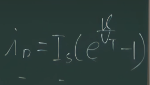
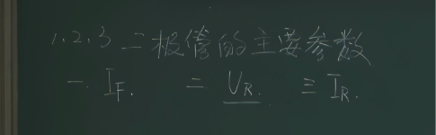
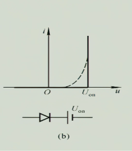
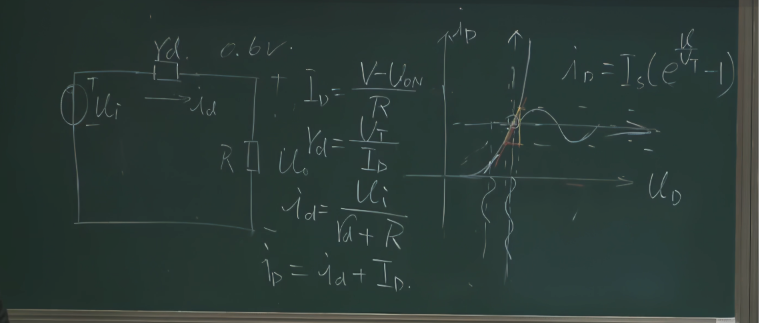
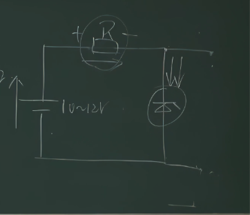

# 二极管

## 反向电压：稳压二极管

## 温度特性：

△ （温度升高 10 ℃，电压翻倍）

△ （温度每升高 1 ℃，正向升高 2–2.5 mV）

_补充：恒定正向电流下，硅 PN 结的正向压降通常随温度升高而下降，常见约为 $-2\,\mathrm{mV}/{}^{\circ}\mathrm{C}$；“升高约 $10\,{}^{\circ}\mathrm{C}$ 翻倍”一般指反向漏电流的经验变化，具体依器件而定。_

## 电流公式：

$i_{D}=I_{S}(e^{\frac{u}{U_{T}}}-1)$

## 二极管四个重要参数：

一：最高正向电流 $I_{F}$

二：最高反向电压 $U_{R}$（超过时发生反向击穿）

三：反向电流 $I_{R}$

四：最高工作频率（超过后会失去单向导电性）

## 二极管等效电路：

由伏安特性曲线得到的等效电路：

图 b：将导通时的电压视为固定值；实际电压仍会变化。

（虽然电压会变化，但当外部电压很大时，这一变化可以忽略。）

$I_{D}=\frac{V-U_{on}}{R}$

$r_{d}=\frac{U_{T}}{I_{D}}$

$i_{d}=\frac{u_{i}}{r_{d}+R}$

$i_{D}=i_{d}+I_{D}$

1：需要先用初始电流建立静态工作点，才能作等效处理（等效为定值电阻）。

2：若直接加入交流而不加初始电流，反向时会截止。

## 稳压二极管（齐纳二极管）：

稳压二极管只有工作在反向击穿区，两端电压才稳定在稳压值 ；

△ 电流太小 → 截止

_补充：稳压管电流不足时，首先是稳压效果变差或离开稳压区，不宜直接等同于截止。_

反向击穿区的伏安特性非常陡：电压只增加一点，电流就会急剧增大。

稳压二极管为什么加电阻？
