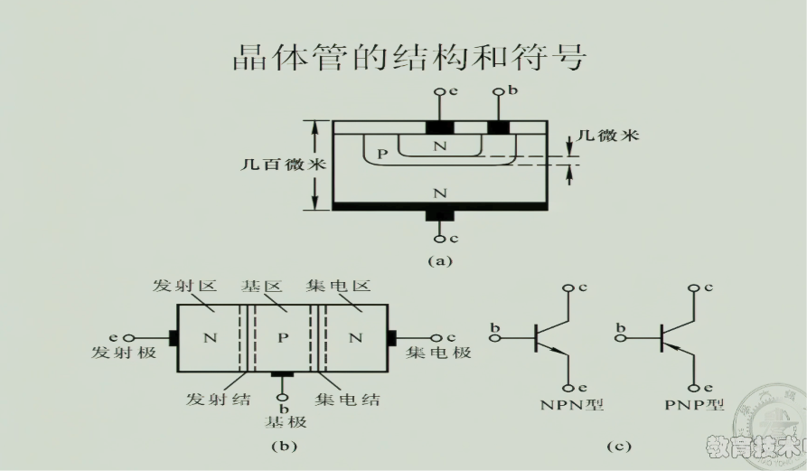
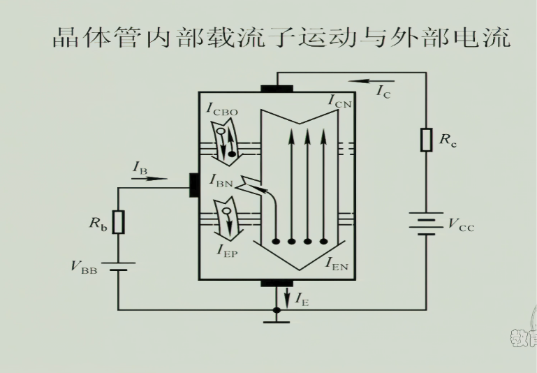
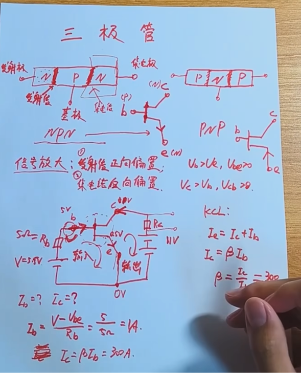
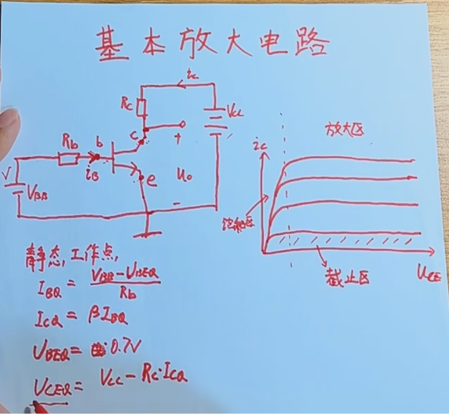
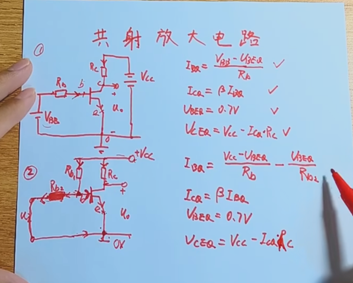
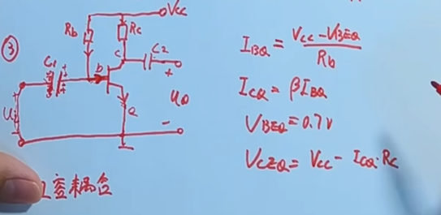

# 三极管
_结构与载流子 · 电流关系 · 工作区 · 共射放大电路_
> **先建立静态工作点，确认晶体管工作在放大区，再分析输入信号引起的微小变化。**
## 1 BJT 的结构与作用
**BJT（三极管）**是具有电流放大作用和开关功能的基本半导体器件，有 NPN、PNP 两种类型。

_晶体管结构与符号。E、B、C 分别表示发射极、基极和集电极。_
- **发射区 E**：掺杂浓度高，便于向基区注入大量载流子。
- **基区 B**：薄且掺杂较轻，使注入载流子在基区的复合较少，大部分能够到达集电结附近。
- **集电区 C**：负责收集载流子；实际结构还要考虑耐压、散热等要求，不能仅用“面积最大、掺杂中等”概括所有器件。

_载流子运动与外部电流的对应关系。_
### 放大区的偏置条件
**发射结正偏、集电结反偏。**下面以 NPN 管为例；PNP 管的电压极性与电流方向相反。
$$U_{BE}=V_B-V_E>0,\qquad U_{BC}=V_B-V_C<0$$
$$V_C>V_B>V_E$$

_电气工程杨课堂截图。下方公式采用统一符号；图中数值试算还需检验电源和负载约束。_
## 2 三个电流与两个放大系数
这里把 NPN 管的 $I_B$、$I_C$ 取为流入器件的正值，$I_E$ 取为流出器件的正值。
$$I_E=I_C+I_B$$
**共基电流放大系数**和**共射电流放大系数**分别定义为：
$$\alpha=\frac{I_C}{I_E},\qquad\beta=\frac{I_C}{I_B}$$
通常 $\alpha$ 接近 1，$\beta$ 常为几十至几百，但具体数值随器件、集电极电流、温度等变化。
$$\beta=\frac{\alpha}{1-\alpha},\qquad\alpha=\frac{\beta}{1+\beta}$$
在放大区、忽略漏电流的近似下：
$$I_C\approx\beta I_B$$
> △ **温度升高时，$\beta$ 的变化必须结合具体器件和工作点判断。**不能单凭“载流子更活跃、复合更少”就认定它始终增大；偏置电路应尽量降低对 $\beta$ 的依赖。
## 3 三个常用工作区
### 截止区
发射结未有效正向导通，通常 $I_B\approx0$、$I_C\approx0$，只剩较小漏电流。仅比较集电极与发射极电位，不能判定导通。
### 放大区
发射结正偏、集电结反偏，NPN 管满足：
$$U_{CE}=V_C-V_E>U_{BE}$$
**这是集电结反偏的条件，不是一个固定的电压门槛。**硅管分析中常近似取 $U_{BE}\approx0.7\,\mathrm{V}$，实际值并不固定。
### 饱和区
**发射结与集电结都正偏。**对常见硅 NPN 管，饱和压降常约为 $0.1\sim0.3\,\mathrm{V}$，需按具体电流与器件核对。
$$U_{CE}\approx U_{CE(\mathrm{sat})},\qquad U_{CE}<U_{BE}$$
饱和时不再满足放大区的电流比例；常见判别近似为：
$$I_C<\beta I_B$$
> **BJT 的饱和是开关充分导通的状态；它与 MOSFET 的“饱和区”含义不同。**
## 4 基本共射放大电路

_发射极接地的基本电路。Q 下标表示静态工作点。_
### 直流分析顺序
**先断开交流耦合通路，求基极电流，再求集电极电流和管压降，最后反查工作区。**
$$I_{BQ}=\frac{V_{BB}-U_{BEQ}}{R_B}$$
$$I_{CQ}\approx\beta I_{BQ},\qquad U_{BEQ}\approx0.7\,\mathrm{V}$$
$$U_{CEQ}=V_{CC}-I_{CQ}R_C$$
若按放大区试算得到的管压降已经落入饱和范围，应改用饱和模型，不能继续机械套用电流放大关系。
### 单电源与基极分压

_上图使用独立基极电源；下图由同一个电源给基极与集电极回路供电。_
发射极接地、上偏置电阻为 $R_{B1}$、下偏置电阻为 $R_{B2}$ 时，对基极节点列电流方程：
$$I_{BQ}=\frac{V_{CC}-U_{BEQ}}{R_{B1}}-\frac{U_{BEQ}}{R_{B2}}$$
**下偏置电阻与上偏置电阻共同决定基极偏置，并分流一部分电流。**它不是“防止基极、发射极短路”的元件；是否处于放大区仍需结合整个电路判断。
## 5 阻容耦合：隔直流、通交流

_输入、输出耦合电容隔开各部分的直流电位，同时传递适当频率范围内的交流信号。_
直流分析中把耦合电容近似开路；在中频段、容抗足够小时，交流分析中可近似短路。
$$|X_C|=\frac{1}{2\pi fC}$$
图示单电源固定偏置电路，发射极接地时：
$$I_{BQ}=\frac{V_{CC}-U_{BEQ}}{R_B},\qquad I_{CQ}\approx\beta I_{BQ}$$
$$U_{CEQ}=V_{CC}-I_{CQ}R_C$$
> **隔直流是对耦合通路而言。放大器本身仍需直流电源和适当偏置。**低频时电容容抗增大，信号也可能被明显衰减。
## 6 动画与课堂链接
△ [原笔记所附三极管放大原理动画](https://www.bilibili.com/video/BV1fB4y147Gn?t=7.1)：与 PN结页链接相同，具体章节和时间点按视频内容核对。
_参考：[MIT BJT 结构与放大区](https://ocw.mit.edu/courses/6-012-microelectronic-devices-and-circuits-fall-2005/fba725b75109fd1dec7c316fc3f74b47_lecture17annotat.pdf) · [MIT BJT 电路与偏置](https://ocw.mit.edu/courses/6-071j-introduction-to-electronics-signals-and-measurement-spring-2006/50a8dea3a2f850d40c9333fefa2db6f1_20_bjt_2.pdf)_
